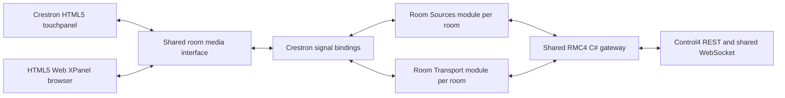

Build walkthroughs and offline mockup are now available: [start here](UI_BUILD_START_HERE.md), [Construct](UI_BUILD_CONSTRUCT.md), [vanilla HTML5](UI_BUILD_VANILLA.md), [join map](UI_JOIN_MAP.md). Metadata captured in CP20a is evidence only; proposed live metadata signals below remain unimplemented.

# Room media interface: touchpanel and Web XPanel

TuneIn implementation is on hold at the user's request. Current priority is a coherent interface and actual now-playing metadata from Control4 to Crestron.

## One interface, two Crestron targets

Use one responsive HTML5/CH5 interface for the Crestron touchpanel and HTML5 Web XPanel browser connection. Both use the existing SIMPL program and RMC4 gateway. This is not a separate browser-to-Control4 integration. No Director credentials or opaque media selectors belong in the UI.

Crestron documents [Web XPanel deployment](https://sdkcon78221.crestron.com/sdk/Crestron_HTML5UI/Content/Topics/Platforms/Web-XPanel.htm), [receiving state through CrComLib](https://sdkcon78221.crestron.com/sdk/Crestron_HTML5UI/Content/Topics/Advanced/Joins-Received-CS.htm), and [publishing events](https://sdkcon78221.crestron.com/sdk/Crestron_HTML5UI/Content/Topics/Advanced/Events-Joins-CS.htm). The shared app should use a small signal adapter around those APIs. Concrete joins/IP ID/Web XPanel deployment settings must be assigned and tested with the user's SIMPL program; module pin names are not automatically Crestron join numbers.

Room selection changes the UI's subscribed join group. It does not rewrite the Room_ID parameter at runtime. Configure one Sources/Transport pair per controlled room, with a room manifest linking friendly names to their join groups. Keep the gateway shared.

## Screen flow

1. Room selector always shows the current room, connection and measured room power.
2. Listen/Watch source cards use that room's discovered source lists and availability. Display friendly names, not protocol/proxy IDs.
3. Selecting a source routes the existing module command. Measured source feedback selects the active card. Automatic service discovery supplies a replacement station/preset list.
4. A station/preset browser shows count, search and touch-sized rows. Its page collector assembles only the current room/kind/revision. Search runs across fetched pages; an unfetched page must not silently disappear from results.
5. Now Playing shows station/preset context separately from track title, artist and album. Artwork remains a placeholder until a verified reference can be rendered. Missing fields stay empty, not inferred from the clicked station.
6. A persistent control bar contains volume/mute/Room Off and supported playback keys. Watch mode can open the larger SR-260 navigation/keypad controls from Transport.

## Current binding map

| UI function | Current SIMPL module contract |
| --- | --- |
| Audio/video source list | Audio_Source_List_JSON$ / Video_Source_List_JSON$, counts/pages and Sources_Valid_FB |
| Select source | Write Source_ID$, then pulse Select_Audio_ID_btn or Select_Video_ID_btn |
| Actual selected source | Audio/Video_Source_Selected_FB plus their validity; indexes refer to the configured slots, not arbitrary IDs |
| Station/preset list | Media_List_JSON$, Media_Item_Count_FB, Media_List_Page_FB / Media_List_Pages_FB and list validity |
| Fetch media page | Media_List_Page_Set; confirm the returned JSON page and revision |
| Select station/preset | Media_Select_Request$ with room_id, kind, current revision and string item ID |
| Volume/mute/off | Sources Volume_Set, Mute_On_btn, Mute_Off_btn, Room_Off_btn; show measured feedback |
| Transport | Transport Play/Pause/Stop/Skip_Back/Skip_Forward and other mapped key inputs; use capabilities to enable keys |
| Pandora shuffle | Pandora_Shuffle_On level, default0; applies to the next station selection |
| Track metadata | Not implemented as live signals yet; CP20a inspection below establishes the actual source data |

Use the existing source-ID input plus pulse instead of depending on an unverified friendly-name string; the earlier literal Spotify name selection produced an unavailable/ambiguous error. Respect ID-write/pulse ordering. Media item JSON is a single serial-change selection and can include a changing request_id for repeat clicks. No selector hex/ST string is sent from the widget.

On a source change, the transient invalid list means loading/clearing, not a valid empty service. Disconnect disables actions and clears current pages. Treat valid=true,total=0 as an empty result; respect partial and selection_supported. Keep Diagnostic$ in an installer log rather than displaying raw HTTP messages as ordinary product text. A production UI will benefit from an explicit per-room structured list status; the gateway's global Busy_FB is not a room-specific loading signal.

A station click can show a pending request. It must not assert actual playback or highlight an actual active station based solely on command acceptance. Playback/metadata feedback should confirm the result.

## Now-playing contract to implement after capture

Keep one measured now-playing state per room in C#, exposed through Sources. Components consume normalized state rather than service-specific Control4 payloads. Suggested fields: source identity, station name, title, artist, album, artwork reference, playback state, observed timestamp and per-field validity. Missing/unverified duration or position must not become fabricated progress or a seek control.

Proposed signals are Now_Playing_JSON$ and Now_Playing_Valid_FB, with optional convenience serial outputs for title/artist/album/station once the actual data is established. These are a design proposal, not existing compiled signals. Source changes, disconnect and stale asynchronous replies must clear/reject old metadata. An artwork cache/reference must be designed after inspecting actual URLs; do not assume the panel can fetch authenticated controller images directly.

The data layer should distinguish room connection, measured source, list revision, pending selection, transport capabilities and measured now-playing fields. The UI may show only the fields whose contracts are verified. Existing Spotify/Pandora list and selection behavior is already RMC4 verified; metadata is the new unverified layer.

## CP20a read-only metadata capture

Added Sources Inspect_Now_Playing. It requires a measured active audio source, reads that source's explicit driver relationship, and GETs variables for room/source/driver plus the renderer identified by CURRENT_AUDIO_DEVICE when present. At most one source-detail GET and four variable GETs. The existing shared WebSocket is observed for 60 seconds for only those item IDs. No additional socket, startup metadata polling, playback command or service change is introduced.

The bounded report stores variable/key/type shapes, recognized display metadata values, raw numeric timing/state observations marked unverified, JSON payload structure and XML tag outlines. Other string values, credentials, selector payloads and artwork URLs are suppressed. XML values are not interpreted until their schema is known. Four room captures are retained; up to32 events/128KiB per capture. Source changes/session changes stop collection for the old source. Inventory includes room_now_playing_inspections.

First RMC4 test: after Sources symbol update/recompile/load, Connect and leave Pandora playing; wait for measured selection/list readiness. Pulse Inspect_Now_Playing. After the variables-recorded diagnostic, press Next once in the Control4 app while keeping the same service. Wait a few seconds and Export_Inventory within the60-second window. Inspect that report before repeating for Spotify. This captures actual data instead of assuming the two services send matching schemas.

Local build/parser/privacy/bounds/offline and existing event/list regressions pass. New capture and live metadata output remain unverified on RMC4. No HTML interface has been deployed yet; the binding map and screen flow above are the implementation baseline.
